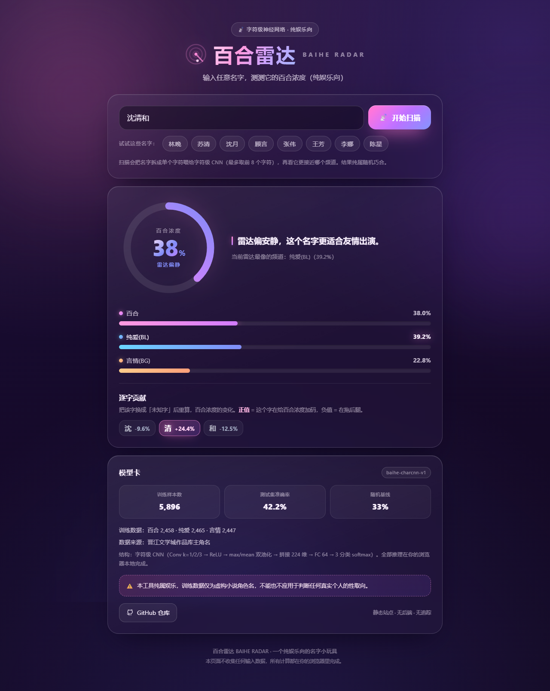

# 百合雷达 Baihe Radar 🏳️‍🌈

> 输入任意名字，用一个小神经网络测测它的「百合浓度」。
>
> **纯娱乐向玩具。** 训练数据全部是虚构小说里的主角名，模型学到的只是网络小说频道的取名风格，
> 不能也不应用于判断任何真实个人的性取向。

**在线体验**：<https://huade520.github.io/baihe-radar/> ｜ **仓库**：<https://github.com/HuaDe520/baihe-radar>



## 它做什么

输入一个名字（比如「沈清和」），浏览器本地跑一个字符级 CNN，输出：

- **百合浓度**：模型认为这个名字属于「百合」频道的概率
- 三分类概率条：**百合 / 纯爱(BL) / 言情(BG)**
- **逐字贡献**：把每个字替换成「未知字」重算，看它给百合浓度加了多少分（遮挡实验）
- 模型卡：训练样本数、测试集准确率、随机基线

全部推理在浏览器里完成，没有后端、没有接口请求、不上传你输入的任何内容。

## 数据是怎么来的

- 来源：**晋江文学城作品库**（`jjwxc.net`）公开页面，按频道取「百合 / 纯爱 / 言情」三个分类：
  - 列表页：`https://www.jjwxc.net/bookbase.php?...&xx0={3|2|1}...&page=N`（`xx0=3` 百合、`2` 纯爱、`1` 言情）
  - 详情页：`https://www.jjwxc.net/onebook.php?novelid=ID`，只读取公开的 `<meta name="Keywords">` 里的
    `主角：...` 字段，并用页面里的 `itemprop="genre"`（文章类型）校验频道关键词，防止串类
- 规模：每频道 20 个列表页，共解析 4,909 本书，得到
  **百合 2,458 / 纯爱(BL) 2,465 / 言情(BG) 2,447** 个去重主角名，合计 **7,370** 条训练样本；
  跨频道同名（78 个）全部剔除
- 只收 2–6 个汉字（允许间隔号 `·`）的名字，过滤「众人」「路人甲」等非人名；全程并发 ≤4 + 随机延时，未触发封禁
- 抓取脚本与原始数据都在仓库里：`data/scrape.py`、`data/names.jsonl`、`data/DATA_REPORT.md`

## 模型

字符级卷积神经网络（从零训练，PyTorch）：

```
字符 embedding 28 维（词表 2,008）
  → 三路卷积 k=1/2/3（32/40/40 通道）
  → ReLU → 每路 max-pool + mean-pool
  → 拼接 224 维
  → FC 64 → ReLU → 输出 3 类 softmax
参数量约 7.7 万，权重导出成 web/model.json，浏览器端 JS 直接前向推理（与 Python 参考实现误差 < 1e-6）
```

训练：train 5,896 / val 737 / test 737（按名字分层切分），Adam + 早停。

| 指标 | 数值 |
| --- | --- |
| 测试集准确率 | **42.2%** |
| 多数类基线 / 随机基线 | 33.45% / 33.3% |
| macro-F1 | 0.4211 |
| 各类 F1（百合 / 纯爱 / 言情） | 0.4235 / 0.4687 / 0.3711 |

坦白说：**只比瞎猜高一点。** 名字和频道取向本来只有很弱的相关性，模型主要学到的是「取名用字的统计风格」。
它是个可以玩的小玩具，不是任何形式的「鉴姬/鉴同」工具。

## 目录结构

```
data/    抓取脚本 + 数据集（names.jsonl / names_clean.jsonl / stats.json / DATA_REPORT.md）
train/   训练与导出脚本（train.py / ref_predict.py / make_vectors.py / metrics.json）
web/     静态站点（index.html / style.css / app.js / inference.js / model.json）
docs/    截图
```

## 本地运行

```bash
# 1. 抓数据（断点续抓，--rebuild 可离线重建）
python data/scrape.py

# 2. 训练 + 导出 web/model.json
python train/train.py

# 3. 生成对拍向量，验证 JS 与 Python 推理一致
python train/make_vectors.py
node web/parity_test.mjs

# 4. 本地预览
python -m http.server 8000 -d web
```

## 免责声明

本工具纯属娱乐，训练数据仅为虚构小说角色名，不能也不应用于判断任何真实个人的性取向。
如果你在真实生活里好奇某个人的取向，最好的办法是尊重对方、等 ta 自己说。
