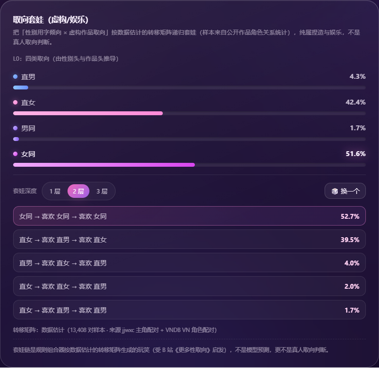

# 百合雷达 Baihe Radar 🏳️‍🌈

> 输入任意名字（中文 / 英文 / **日文** / 罗马音 / 网名），用一个小神经网络做「名字雷达」：
> 性别倾向、ACG 属性、ACG 百合角色、角色取向（虚构）、百合指数，以及一张「取向套娃」娱乐卡。
>
> **纯娱乐向玩具。** 训练数据是真实姓名统计 + 虚构角色/小说数据；不能也不应用于判断任何真实个人的性取向或性别身份。

**在线体验**：<https://huade520.github.io/baihe-radar/> ｜ **仓库**：<https://github.com/HuaDe520/baihe-radar>


## 它输出什么（v6 五头）

| 输出 | 数据 | 说明 |
| --- | --- | --- |
| **性别倾向** 女/男 | 真实姓名语料 8 万条（中文 4 万 + 外国名 4 万）+ VNDB 日文名 4,978 条 | 「名字用字像女名/男名」，统计倾向，不是身份判断；日文名/罗马音也能算 |
| **ACG 属性** 伪娘/扶她/伪郎/普通 | 萌娘百科角色分类 1,054 条 | 只对二次元角色名有参考价值 |
| **ACG 百合角色** 其他角色/百合角色 | 萌娘百科「分类:百合」角色 + VNDB 百合向 VN 角色 | 虚构角色标签，非真人 |
| **角色取向（虚构）** 百合/纯爱(BL)/直向 | 晋江作品频道主角名 18,113 条 | 用小说频道标签当虚构角色取向的代理 |
| **百合指数** | 同上（二分类头） | 页面大圆环 |

支持**中英文混输 + 日文 + 网名**：`林晚`、`Alice`、`フォーニ`、`渡良瀬 準`、`林晚_233`、`xX_张伟_Xx` 都能跑（训练时做了数字/下划线网名增广，并加入日文角色名）。

## 数据从哪来

- **真实姓名（性别）**：[Chinese-Names-Corpus](https://github.com/wainshine/Chinese-Names-Corpus) 的中文姓名性别语料（抽 4 万）+ 外国名语料（抽 4 万，含中文音译与拉丁原名）
- **日文名（性别）**：[VNDB](https://vndb.org) 公开角色 API：4,473 个角色的日文原名 + 罗马音 + 性别；日文名单独成组训练（日文性别头 65.3%，比中文低，样本还小）
- **ACG 性别表达 / 百合角色**：萌娘百科公开分类页（伪娘 / 扶她 / 伪郎 / 女装 / 男装 / 分类:百合 / 按生日分类负样本），抓取脚本 `data/scrape_moegirl.py`
- **作品频道 / 百合判定**：晋江文学城作品库三个频道（`xx0=3/2/1`）公开「主角名」字段，11,742 本书 → 18,113 个去重主角名（见 `data/DATA_REPORT.md`）
- **取向套娃转移矩阵（数据估计）**：晋江「主角配对」11,274 对 + VNDB「同一 VN 角色配对」2,134 对 → 4×4 转移矩阵（弱先验平滑，强度 300），脚本 `train/learn_orientation_priors.py`；页面会把矩阵数值和来源一起显示

## 模型（v6 五头）

```
字 embedding 32 + 位置 embedding 8（拼接 40 维/位置，max_len=12，支持中/英/日混输）
  → 三路卷积 k=1/2/3（64/96/96 通道）+ BatchNorm → ReLU
  → 每路 max-pool + mean-pool（512 维）→ 拼首字/末字 embedding（576）
  → FC 160 → ReLU → 5 个分类头
参数量约 27 万，权重导出 web/model.json（约 1.9 MB），浏览器端 JS 前向推理
（与 numpy 参考实现 5 头误差 < 1e-6，230 条对拍通过）
```

| 指标 | 数值 |
| --- | --- |
| 性别 · 中文名 | **97.1%**（4,000 条测试） |
| 性别 · 外国名/音译 | **87.6%** |
| 性别 · 日文名 | 65.3%（496 条测试，样本少、假名性别更模糊） |
| ACG 属性（4 类） | acc 60.2% / 平衡 **63.9%** |
| ACG 百合角色（2 类） | acc **83.1%** / 平衡 **71.5%** |
| 角色取向（3 类） | acc 44.4%（多数类基线 33.5%） |
| 百合指数平衡准确率 | 56.2% |

## 取向套娃（虚构/娱乐，v5/v6）

受 [B 站《更多性取向》](https://www.bilibili.com/video/BV1KauJ6xEPT/) 启发，把「取向」看成**递归关系**而不是单标签：
`取向 = (自己性别, 喜欢的对象的类型)`，而「喜欢的对象的类型」自己也可以有取向，于是可以套娃 N 层（视频里叫「爱的 N 次方」）。

- **L0 四类**：直男 / 直女 / 男同 / 女同，由性别头与作品频道头组合推导；
- **L1~L3**：转移矩阵 **从公开数据学出来**（晋江主角配对 + VNDB VN 角色配对，13,408 对；弱先验平滑），再递归展开，展示 top5 链，例如 `女同 → 喜欢 女同 → 喜欢 直男`；
- 概率 = L0 × 每层转移概率，top5 归一化；可切 1/2/3 层、可「🎲 换一个」；
- 页面上直接标注「转移矩阵：数据估计（13,408 对样本 · 来源 jjwxc 主角对 + VNDB VN 角色对）」。

⚠️ 套娃链是**娱乐规则 + 公开数据统计**，不是模型预测，更不是对任何真人的取向判断。数据里几乎观察不到跨类型边（比如「男同喜欢直男」没有可靠公开标签），所以矩阵主结构是「同向/直向」，跨类型边来自弱先验平滑。



## 为什么不做「真实公众人物的性取向概率」？

性取向/性别认同属于敏感个人信息；「公开出柜」只代表本人选择公开，**不能反推没公开的人是异性恋**，
拿「公开 vs 未公开」训练出来的模型学到的其实是名人/网名风格，不是取向，指标再高也是假的。
这类工具还容易被用来给真人贴标签、逼人出柜。所以本项目只做：
**真实姓名的性别统计**（匿名语料，97.1%/87.6%）、**虚构角色/小说的取向代理**（不指向真人）。

## 和同类玩具的区别

参考过 [Akanyi/Gaynum](https://github.com/Akanyi/Gaynum)：纯前端**确定性哈希**，README 自认「结果纯随机，没有任何依据」，没有数据集也没有准确率。
本项目真的训练了 5 个头（真实姓名 + VNDB 日文名 + 萌娘百科 + 晋江），且有公开数据估计的取向转移矩阵，所以有这些诚实（也不算高）的数字。

## 目录结构

```
data/    抓取脚本 + 数据集（names*.jsonl / moe_*.jsonl / vndb_*.jsonl / stats.json / DATA_REPORT.md / PREPARE.md）
train/   训练与导出（train_v6.py / ref_predict_v4.py / make_vectors_v6.py / learn_orientation_priors.py / metrics_v6.json）
web/     静态站点（index.html / style.css / app.js / inference.js / orientation.js / orientation_priors.json / model.json）
docs/    截图
```

## 本地运行

```bash
# 1. 姓名语料（仓库外）
git clone --depth 1 https://github.com/wainshine/Chinese-Names-Corpus.git D:\names-corpus

# 2. 可选：抓 ACG 角色 + VNDB 日文角色（仓库已带派生数据）
python data/scrape_moegirl.py
python data/scrape_vndb.py && python data/build_vndb_data.py

# 3. 训练 v6 + 导出
python train/train_v6.py --corpus-root D:\names-corpus --out web/model.json

# 4. 学取向转移矩阵（数据估计）
python train/learn_orientation_priors.py

# 5. 对拍 + 预览
python train/make_vectors_v6.py web/model.json
node web/parity_test.mjs
python -m http.server 8000 -d web
```

## 免责声明

本工具纯属娱乐。性别/属性输出只是名字用字的统计倾向，不能用于判断任何真实个人的性取向或性别身份；
真人请尊重其本人自我认同。ACG 属性与百合角色只对二次元角色名有参考价值；角色取向与套娃矩阵基于虚构作品数据。
